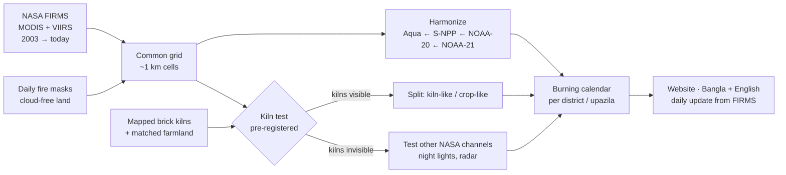

# 🔥 Kiln Watch

### Two fires, one sky: a corrected burning calendar for Bangladesh

**NASA Space Apps Challenge 2026 · Theme: *The Next Frontier***
**Challenge:** Harmonization of MODIS and VIIRS Hot Spots
**Local Event:** Mymensingh, Bangladesh · Hackathon 13–14 November 2026

> **Stage: concept.** This repository holds our idea, our plan, the tests we will run and the NASA data we will use. Space Apps rules say teams may not start building before the hackathon, so the software itself is built on 13–14 November 2026 and pushed here during the event.

---

## The idea in 30 seconds

Every dry season, Bangladesh burns twice:

1. **Crop fires.** After the Aman and Boro rice harvests, farmers burn leftover straw.
2. **Brick kilns.** Thousands of kilns fire from about November to April, and they are a major source of winter smog.

NASA satellites have watched these fires since 2003. But in 2012 the "camera" changed. The older **MODIS** sensor sees the ground in ~1 km squares; the newer **VIIRS** sensor sees 375 m squares and catches many small fires MODIS missed. If you join the two records, burning appears to jump in 2012. The fires didn't change. The camera did.

And it gets urgent this year: **S-NPP VIIRS stops delivering data in November 2026, and MODIS on Terra and Aqua is due to end in 2027.** Without a bridge between sensors, the 23-year fire record breaks for good.

**Kiln Watch** will:

- 🛰️ **Harmonize** MODIS and VIIRS into one consistent unit, so 2005 and 2026 can be compared honestly, with an error range on every number.
- 🧱 **Test** whether brick-kiln heat is hiding inside the fire record, and if it is, separate it from crop fires.
- 📅 **Publish** a plain-language burning calendar for every district and upazila, starting with **Mymensingh division**, then all of Bangladesh.

---

## Why Mymensingh first

Mymensingh division (Mymensingh, Jamalpur, Sherpur, Netrokona) is rice country, with haor wetlands, Aman and Boro harvests, and brick kilns along its rivers and roads. It has both kinds of burning side by side. That makes it the right place to prove the method before scaling it to all 64 districts, and it gives our Local Event a result that people in the room can check against their own experience.

---

## How it will work

Full concept: [`docs/proposal.md`](docs/proposal.md)

---

## NASA data we will use

| Dataset | Source | What we use it for |
|---|---|---|
| **FIRMS MODIS C6.1** active fire (Terra, Aqua) | NASA FIRMS | Fire record 2003 → today; Aqua is our anchor sensor |
| **FIRMS VIIRS 375 m** active fire (S-NPP, NOAA-20, NOAA-21) | NASA FIRMS | Fire record 2012 → today; near-real-time for this season |
| **MOD14A1 / MYD14A1 / VNP14A1** daily fire masks | NASA LP DAAC (via Earthdata / Earth Engine) | How much land was cloud-free each day, so cloud is never counted as "no fire" |
| **VJ114A1 / VJ214A1** (NOAA-20/21 daily fire) | NASA Earthdata | Cloud-free counts after S-NPP ends |
| **Black Marble VNP46A2** night lights | NASA LAADS DAAC | Backup kiln test: kilns run through the night |
| **ECOSTRESS** and **Landsat 8/9** surface temperature | NASA / USGS | Backup kiln test: can a sharper thermal sensor see kilns? |

Partner and other data: Sentinel-1 radar and Sentinel-5P TROPOMI (ESA/Copernicus), ESA WorldCover, APAD IGP Brick Kilns Bangladesh (CC BY 4.0), HDX district and upazila boundaries, OpenAQ PM2.5.

Dataset-by-dataset plan: [`docs/nasa-data.md`](docs/nasa-data.md)

---

## The tests we will run

We write every pass/fail rule down **before** the build, so the results can't be bent to fit the story. Every outcome, pass or fail, is published.

| # | Question | Pass rule (fixed in advance) |
|---|---|---|
| T1 | Does harmonization remove the fake 2012 jump? | Corrected jump ≤ 25% of the raw jump; a statistical break in the raw record and none after correction |
| T2 | Are our error ranges honest? | Leave-one-season-out: 95% ranges contain the truth 90–97% of the time |
| T3 | Does the corrected record agree with a sensor that never changed? | Corrected values fall within the range Aqua MODIS actually measured, 2012–2021 |
| T4 | Can NASA fire satellites see brick kilns at all? | Kilns vs matched farmland: ≥ 3× detection rate, a season-long "plateau" shape, ≥ 3× dry-season vs monsoon |
| T5 | If not, can another NASA sensor see kiln *activity*? | Night lights / radar brighter in kiln season than matched farmland, on held-out kilns, with a placebo test |
| T6 | Does the bridge survive S-NPP's shutdown? | NOAA-20/21 chain predicts held-out months within its error range |
| U1 | Can ordinary people use it? | 5+ adult testers in Mymensingh find their upazila's burning season in under 60 seconds, 80% success |

Full rules, statistics and what we do in each outcome: [`docs/test-plan.md`](docs/test-plan.md)

---

## What people will see (concept)

| Page | What a visitor does |
|---|---|
| **My area** | Tap the map or search a district/upazila → when its burning season is, whether this season is unusual, a typical year month by month |
| **Kiln calendar** | When kilns work in each area, and how that season has changed over the years |
| **Sensor switch** | A small puzzle that shows *why* the 2012 jump is fake, then fixes it |
| **Agun Ponjika** (আগুন পঞ্জিকা) | A one-page printable "fire almanac" for an upazila, in Bangla, for a union office notice board |
| **For experts** | Method, every test and its result, data downloads, code |

Wireframes and user stories: [`docs/proposal.md#the-website`](docs/proposal.md#the-website)

---

## Repository map

| Path | What it is |
|---|---|
| [`docs/proposal.md`](docs/proposal.md) | The full concept: problem, users, solution, website, responsible release, what we will not claim |
| [`docs/nasa-data.md`](docs/nasa-data.md) | Every dataset: what, why, how we access it, licence |
| [`docs/test-plan.md`](docs/test-plan.md) | Pre-registered hypotheses and pass/fail rules |
| [`docs/hackathon-plan.md`](docs/hackathon-plan.md) | How we use the 2 days: roles, hour-by-hour plan, scope tiers, risks |
| [`docs/event-rules.md`](docs/event-rules.md) | Bangladesh + Mymensingh rules, dates, videos and judging, as we understand them |
| [`pitch/videos.md`](pitch/videos.md) | Scripts and beat sheets for our three videos |

---

## Team

**Team name:** _to be added_ · **Local Event:** Mymensingh

| Member | Role |
|---|---|
| _Name_ | Team lead · data pipeline |
| _Name_ | Remote sensing and statistics |
| _Name_ | Web app and maps |
| _Name_ | Design, Bangla content and user testing |
| _Name_ | Story, video and presentation |

---

## Roadmap

- [x] Read the 2026 Bangladesh Participants Guide and the challenge summary
- [x] Write the concept, data plan and test plan (this repository)
- [ ] Bangladesh portal: 240-second Video 1 + this repository link
- [ ] Register the team on spaceappschallenge.org and select the Mymensingh Local Event
- [ ] Create NASA Earthdata and FIRMS MAP_KEY accounts; download datasets offline before the event
- [ ] **28 Oct:** read the full challenge statement; update the challenge table in the proposal
- [ ] **13 Nov:** build day 1; Video 2 (240 s, with demo and NASA data named on camera) by 6:30 PM
- [ ] **14 Nov:** Video 3 (30 s, English subtitles) by 12:00 PM; NASA project page submitted

---

## Licence

Everything we build at the event will be open source under the [MIT licence](LICENSE). All datasets keep their own licences and are credited in [`docs/nasa-data.md`](docs/nasa-data.md).

*Not affiliated with or endorsed by NASA. Built on NASA open data.*
