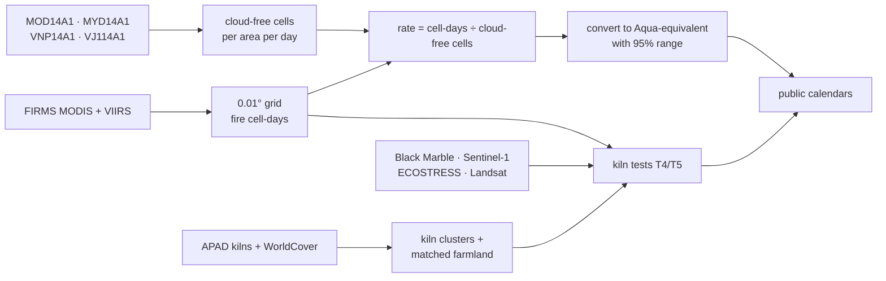

# NASA Data Plan

NASA open data is the core of Kiln Watch, not an add-on. This page lists every dataset we plan to use, why, how we will access it, and its licence. All large downloads happen **before** the event and are cached offline, as the Bangladesh guide recommends.

## Accounts needed before the event

- [ ] NASA Earthdata Login (free): https://urs.earthdata.nasa.gov
- [ ] FIRMS MAP_KEY (free): https://firms.modaps.eosdis.nasa.gov/api/map_key/
- [ ] Google Earth Engine (free for non-commercial use), for cloud-free counts without multi-GB downloads

---

## 1. Core NASA data

### NASA FIRMS: MODIS Collection 6.1 active fire (Terra + Aqua)

| | |
|---|---|
| **What** | Every fire detection by MODIS: location, time, brightness temperature, fire radiative power (FRP), confidence, day/night, scan/track pixel size, and `type` (vegetation / static land source / ...) in the archive |
| **Years** | 2003 → today over Bangladesh (Aqua from mid-2002) |
| **Why** | The long record before 2012. **Aqua is our anchor sensor**: everything is converted to Aqua-equivalent units |
| **Access** | FIRMS archive download (country = Bangladesh) and FIRMS Area API |
| **Link** | https://firms.modaps.eosdis.nasa.gov |

### NASA FIRMS: VIIRS 375 m active fire (S-NPP, NOAA-20, NOAA-21)

| | |
|---|---|
| **What** | The same fields at 375 m resolution. Standard archive for past years; near-real-time (NRT) for the current season |
| **Years** | S-NPP 2012 → Nov 2026 · NOAA-20 2018 → · NOAA-21 2023/24 → |
| **Why** | The modern record, and the **bridge** that keeps it going after S-NPP and MODIS end |
| **Access** | FIRMS archive + Area API (`FIRMS_MAP_KEY`) |
| **Note** | NRT data has no `type` field, so any kiln/crop split for the current season must come from our own method |

### Daily fire masks: MOD14A1, MYD14A1, VNP14A1

| | |
|---|---|
| **What** | Daily per-pixel class: fire, clear land, cloud, water, unknown |
| **Why** | **Cloud correction.** A cloudy day must never look like a day with no fire. Activity = fire cell-days ÷ cloud-free cells |
| **Access** | Google Earth Engine or LP DAAC via Earthdata |

### VJ114A1 / VJ214A1 (NOAA-20 / NOAA-21 daily fire)

| | |
|---|---|
| **What** | The NOAA-20 and NOAA-21 equivalents of VNP14A1 |
| **Why** | Cloud-free counts once S-NPP stops in November 2026 |
| **Access** | NASA Earthdata (`earthaccess` Python library) |

---

## 2. NASA data for the kiln test (T4 / T5)

### Black Marble VNP46A2: daily night lights

| | |
|---|---|
| **What** | Moonlight- and atmosphere-corrected night-time radiance at ~500 m |
| **Why** | Kilns are worked through the night with lamps and crews. If fire sensors cannot see kilns, night lights may still show **when they are working** |
| **Access** | NASA LAADS DAAC; also available in the Earth Engine catalog |
| **Reference** | Román et al. 2018, *Remote Sensing of Environment* |

### ECOSTRESS L2T LSTE (70 m surface temperature)

| | |
|---|---|
| **What** | Land surface temperature from the International Space Station, day and night |
| **Why** | A sharper thermal eye: can a 70 m pixel see a kiln's heat that a 375 m pixel cannot? |
| **Access** | NASA LP DAAC via Earthdata |

### Landsat 8/9 Collection 2 surface temperature (NASA/USGS)

| | |
|---|---|
| **What** | 100 m thermal band, resampled to 30 m |
| **Why** | Another sharp thermal check, mostly daytime |
| **Access** | Earth Engine (`LANDSAT/LC08/C02/T1_L2`, `LANDSAT/LC09/C02/T1_L2`) |

---

## 3. Space Agency Partner and other open data

| Dataset | Provider | Used for | Licence |
|---|---|---|---|
| Sentinel-1 SAR (C-band radar) | ESA / Copernicus | Kiln activity check: fresh brick stacks in kiln yards change the radar signal | Copernicus open licence |
| Sentinel-5P TROPOMI NO₂ / SO₂ | ESA / Copernicus | Does air pollution follow the kiln season? | Copernicus open licence |
| Sentinel-2 surface reflectance | ESA / Copernicus | Looking at kiln sites by eye | Copernicus open licence |
| ESA WorldCover 10 m | ESA | Matching each kiln to farmland with the same land cover | CC BY 4.0 |
| ERA5-Land | ECMWF / Copernicus | Weather controls when comparing with PM2.5 | Copernicus licence |
| APAD IGP Brick Kilns Bangladesh | AWS Open Data | Mapped kiln locations | CC BY 4.0 |
| SentinelKilnDB | NeurIPS 2025 dataset | Cross-check of kiln locations (validation only) | CC BY-NC |
| HDX COD-AB Bangladesh | OCHA | Division, district and upazila boundaries | CC BY-IGO |
| OpenAQ | OpenAQ | Dhaka and regional PM2.5 for comparison | CC BY 4.0 |
| Crop calendar, policy dates | Hand-built from cited government and research sources | Harvest windows; 2013 Act and 2019 amendment on the timeline | Each row cited |

---

## 4. How the data flows

## 5. Data rules we follow

- **Never add raw counts across sensors.** Each sensor is divided by its own cloud-free opportunities first.
- **The same confidence rule for every sensor** (keep nominal + high), with sensitivity runs at "all" and "high only".
- **Every dataset is credited** on the website's Method page, in this repository, and in the NASA project page's *NASA data sources used* and *References* fields.
- **Area-level statistics only** in public files. No kiln coordinates or IDs are published.
