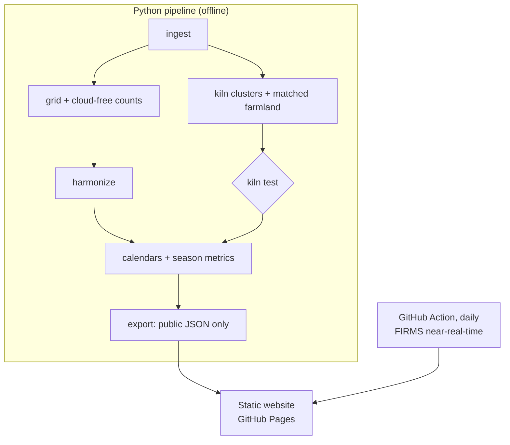

# Kiln Watch: Concept Proposal

| | |
|---|---|
| **Event** | NASA Space Apps Challenge 2026 · Bangladesh · Mymensingh Local Event · 13–14 Nov 2026 |
| **Challenge** | Harmonization of MODIS and VIIRS Hot Spots |
| **Theme** | The Next Frontier: "from your own backyard to the edges of the universe" |
| **Stage** | Concept. Built during the hackathon, as the rules require |

---

## 1. The challenge, as we read it

The challenge summary asks for a tool that joins NASA's two active-fire records, **MODIS** (2000 →) and **VIIRS** (2012 →), into one consistent **burning-activity calendar**. Its users are early-warning and emergency responders, scientists and land managers who want to see historical fire patterns, unusual conditions and critical periods for an area they choose.

> The full challenge statement is published on 28 October 2026. On that day we quote its objectives here word for word and re-check every row of the table below.

| What the challenge asks for | How Kiln Watch answers it |
|---|---|
| Harmonize MODIS and VIIRS | A calibrated common unit, a chain of sensors from Aqua to NOAA-21, and a 95% error range on every value |
| A burning-activity calendar | A year × day calendar for any district, upazila or drawn box, with a raw / corrected switch |
| Historical fire patterns | Season start, peak, middle and length for every year since 2003 |
| Unusual conditions | Days above the area's normal range (90th percentile) |
| Critical periods | The weeks when an area's normal calendar is in its top quarter |
| Early warning | This season against the normal range, refreshed daily from FIRMS near-real-time data |
| Area of interest | District, upazila, or a box drawn on the map |
| **Our addition** | A test of whether brick-kiln heat is mixed into the fire record, and a kiln calendar beside the fire calendar |

**Where we stand on scope.** The brief is about wildfires and agricultural burning, and kilns are neither. So the **harmonized calendar is the core deliverable**. The kiln work is what makes that calendar trustworthy for Bangladesh.

---

## 2. The problem

### 2.1 The fire record breaks in 2012

| | MODIS (Terra, Aqua) | VIIRS (S-NPP, NOAA-20, NOAA-21) |
|---|---|---|
| Pixel size | ~1 km | 375 m |
| Record starts | 2000 (Terra), 2002 (Aqua) | 2012 (S-NPP), 2018 (NOAA-20), 2023 (NOAA-21) |
| Small fires | Often missed | Often seen; one fire can make several detections |
| End of life | Terra planned to end ~early 2027, Aqua ~2027 | S-NPP data delivery ends November 2026 |

In one published agricultural study, VIIRS found about **4.8× more fires** than Terra and Aqua MODIS together. Joining the records as they are measures the satellites, not the fires.

### 2.2 In Bangladesh, two kinds of burning share one season

Crop-residue burning and brick-kiln firing happen in the same dry months (roughly November to May). Two things can go wrong:

- If kiln heat is counted as vegetation fire, the "crop burning" calendar is partly a kiln calendar.
- If kilns are flagged as static industrial sources and thrown away, kiln activity disappears from view entirely.

**Nobody knows yet which of these is happening**, or whether fire satellites see kilns at all. Kilns burn inside closed brick chambers. That is a real scientific question, and we treat it as one (see [`test-plan.md`](test-plan.md), T4 and T5).

### 2.3 Why it matters

- Brick kilns are widely reported as one of the largest sources of Dhaka's winter PM2.5. Published estimates vary a lot, and we will cite primary sources only.
- Thousands of kilns operate in Bangladesh; peer-reviewed mapping found most of them near schools (Lee et al. 2021, PNAS).
- The Brick Kiln Act 2013 (amended 2019) regulates where and when kilns may operate, but there is no long, consistent record of **when** kiln areas are active.
- Farm officers, disaster responders and families need to know when burning season is in their area, and whether this year is unusual.

---

## 3. Who it is for

| User | What they decide differently |
|---|---|
| **Families and schools** in Mymensingh and beyond | When to expect smoky weeks; when to keep windows closed |
| **Upazila agriculture officers** | When to run straw-management outreach before the harvest burning peak |
| **Department of Environment inspectors** | Which weeks of the year kiln areas are most active, to plan inspection rounds |
| **Disaster and early-warning teams** | Whether this season is running above normal in their district |
| **Scientists and journalists** | Whether a fire trend is real or a sensor artefact |
| **Other brick-belt countries** (India, Nepal, Pakistan) | Whether the same method works for them |

---

## 4. The solution

### 4.1 Three layers

| Layer | What it delivers | Ships in every outcome? |
|---|---|---|
| **1. Harmonized burning calendar** *(core)* | One consistent fire calendar 2003 → today for any area, with error ranges | ✅ Yes |
| **2. Kiln test** | A published answer to "can fire satellites see kilns?", with matched farmland as the comparison | ✅ Yes, the answer is a result either way |
| **3. Kiln calendar** | When kilns work in each area and how that has changed | Only if T4 or T5 passes |

### 4.2 Harmonization: how we make the satellites agree

1. **Common grid.** Put every detection on a ~1 km (0.01°) grid. A cell scores one *fire cell-day* if it has at least one detection that day, per sensor and per day/night pass. This absorbs most of the "one fire, many VIIRS pixels" problem.
2. **Cloud correction.** Divide by how many cells were cloud-free that day (from NASA's daily fire masks). A cloudy day is reported as *not observed*, never as zero.
3. **One unit.** Convert everything to *Aqua-MODIS-equivalent fire cell-days per 1,000 cloud-free cells*. Aqua is the anchor because it crosses Bangladesh at almost the same time as S-NPP VIIRS (≈ 1:30 pm / 1:30 am), so the conversion measures the sensor, not the time of day.
4. **A chain of sensors.** Learn the conversion where two satellites overlap: Aqua ↔ S-NPP, then S-NPP ↔ NOAA-20, then NOAA-20 ↔ NOAA-21. The record keeps going after S-NPP and MODIS end.
5. **Error ranges.** Bootstrap the conversion by whole seasons and add count noise, so every number carries a 95% range.

### 4.3 The kiln test

1. Take mapped kiln locations (APAD IGP Brick Kilns Bangladesh, open licence) and group nearby kilns into **clusters**, because several kilns can sit inside one satellite pixel.
2. Give every cluster **three matched farmland sites**: same district, same land-cover class, 5–10 km away, same footprint shape. Random controls would be unfair, because kilns sit where fields burn.
3. Compare fire detections at kilns and their matched farmland, using rules written in advance (T4).
4. **If fire satellites see kilns:** train a small classifier on physical clues (brightness temperatures, fire power, night vs day, persistence, isolation) to label each detection *kiln-like*, *crop-like* or *unknown*. Location and date are **not** features, so it cannot just memorise where kilns are.
5. **If they don't:** that is good news for the fire calendar (nothing to remove), and we test whether other NASA and partner sensors can see kiln **activity** instead of kiln **fire** (T5): night lights, radar, sharper thermal sensors.

### 4.4 Products

- **Season numbers** for every area and year: middle of the season, length (10th–90th percentile of activity), peak week. First and last fire dates are shown only with a warning, because they depend on how many satellites were flying.
- **Normal range** per day of the year, so "unusual" has a clear meaning.
- **This season**, refreshed daily from FIRMS near-real-time, clearly labelled *provisional*.
- **Agun Ponjika (আগুন পঞ্জিকা).** A printable one-page "fire almanac" per upazila in Bangla, in the style of a traditional panjika calendar, for union parishad and school notice boards. It turns a satellite record into something you can pin to a wall.

---

## 5. The website

A static site (no server): fast, cheap to host on GitHub Pages, and it keeps working on a weak connection.

```
┌──────────────────────────────────────────────────────────────┐
│ 🔥 Kiln Watch     My area · Kiln calendar · Sensor switch ·  │
│                   Agun Ponjika · For experts      [EN | বাংলা] │
├──────────────────────────────┬───────────────────────────────┤
│                              │  Netrokona Sadar              │
│     [ map of Bangladesh,     │  Burning season: mid-Mar →    │
│       Mymensingh division    │  early May (peak: late Apr)   │
│       highlighted ]          │  This season: ● normal so far │
│                              │                               │
│  🔍 Search district/upazila  │  Jan Feb Mar Apr May ... Dec  │
│  📍 Use my location          │  ░░░ ░░░ ▒▒▓ ███ ▓▒░ ... ░░░  │
│                              │  [ raw | corrected ]          │
└──────────────────────────────┴───────────────────────────────┘
```
*(Layout sketch only; the values shown are placeholders, not results.)*

| Page | User story |
|---|---|
| **My area** | "As a teacher in Netrokona, I want to know which weeks are smoky so I can plan outdoor classes." |
| **Kiln calendar** | "As an inspector, I want to see which months kiln areas in my district are active." |
| **Sensor switch** | "As a student, I want to understand why the 2012 jump is fake." A short guided puzzle: switch satellites on and off, then apply the correction. |
| **Timeline** | "As a journalist, I want fire activity, kiln seasons, laws and satellite launches on one line." |
| **Agun Ponjika** | "As a union parishad member, I want a one-page Bangla calendar I can print and pin up." |
| **For experts** | "As a scientist, I want every test, its pre-registered rule, the code and the data." |

**Design rules:** every chart has a one-sentence plain-language summary; colour-blind-safe palette with patterns; full keyboard use; Bangla and English; "Use my location" is matched to an area on the device and never sent anywhere.

---

## 6. Responsible release

Showing individual kilns publicly could harm kiln owners and workers on the basis of a method that is still being tested, and mapping is better in cities than villages.

| Tier | Contents | Where |
|---|---|---|
| **Public** | District and upazila calendars, season numbers, all test results | Website and repository |
| **Restricted** | Anything at the level of a single kiln or cluster | Never hosted. An offline file for the regulator, only on request |

An automated check will block kiln IDs and coordinates from ever reaching the public site.

### What we will not claim

1. That any kiln is operating illegally. Our outputs are, at most, leads.
2. That a kiln was off because nothing was detected. We only say "no detection on N cloud-free days".
3. That detection counts are emissions.
4. That the 2013 Act caused any change. Before/after comparisons are descriptive.
5. That the conversion holds outside the place and years it was learned on.
6. That thermal kiln detection is an established method. It is a hypothesis we test in public.

---

## 7. Architecture (planned)



| Layer | Tools |
|---|---|
| Pipeline | Python 3.11, pandas, GeoPandas, scikit-learn, SciPy |
| Satellite processing | NASA FIRMS API, NASA Earthdata (`earthaccess`), Google Earth Engine |
| Website | React + TypeScript + Vite, Leaflet maps, ECharts |
| Hosting and updates | GitHub Pages, GitHub Actions |
| Quality | pytest, Vitest, one end-to-end smoke test |

---

## 8. What is new

**Already exists:** optical deep-learning maps of *where* kilns are (Lee et al. 2021; SentinelKilnDB 2025); several fire-calendar tools.

**What Kiln Watch adds:**

1. **The time axis.** *When* kiln areas are active, season after season, not only where kilns are.
2. **A sensor bridge that outlives S-NPP and MODIS**, with tested error ranges.
3. **A pre-registered, public test** of whether fire satellites can see kilns at all, with matched farmland as the control. The answer is useful whichever way it goes.
4. **Agun Ponjika:** satellite science turned into a printable Bangla almanac for people who will never open a web map.

---

## 9. How it maps to the judging criteria

| Criterion | What we will show |
|---|---|
| **Impact** | A corrected fire record for one of the world's most kiln-dense countries; uses for families, farm officers, inspectors and responders; a method other brick-belt countries can reuse |
| **Creativity** | Separating industrial heat from crop fire inside a harmonized record; the Sensor-switch puzzle; Agun Ponjika |
| **Validity** | Rules fixed before the build, matched controls, held-out testing, error ranges, placebo tests, written non-claims |
| **Relevance** | Every element of the brief mapped to a feature; NASA FIRMS and NASA fire masks are the core, not a decoration |
| **Presentation** | One clear story: "the satellites changed glasses in 2012, and we corrected the prescription" |
| **NASA data usage** | NASA data at the centre, plus ESA, Copernicus and open kiln inventories, all credited |
| **User experience** | Tap your area, read one sentence; tested with real adult users in Mymensingh |

---

## 10. Future work

- Extend to the brick belt of India, Nepal and Pakistan using open kiln inventories.
- An order-of-magnitude kiln emissions estimate, clearly labelled as such.
- SMS or Facebook alerts in Bangla when a district's season runs above normal.

---

## 11. Key references

- FIRMS active fire data attributes: https://www.earthdata.nasa.gov/data/tools/firms/active-fire-data-attributes-modis-viirs
- VIIRS 375 m active fire product: https://www.earthdata.nasa.gov/data/instruments/viirs/viirs-i-band-375-m-active-fire-data
- NOAA notice, S-NPP data cessation: https://www.nesdis.noaa.gov/news/cessation-of-suomi-national-polar-orbiting-partnership-s-npp-data-users-onafter-november-2-2026
- MODIS → VIIRS transition: https://www.earthdata.nasa.gov/data/alerts-outages/transition-from-modis-viirs
- Schroeder et al. 2014, VIIRS 375 m fire algorithm: https://www.earthdata.nasa.gov/sites/default/files/imported/Schroeder_et_al_2014b_RSE.pdf
- MODIS vs VIIRS in an agricultural landscape: https://pmc.ncbi.nlm.nih.gov/articles/PMC6108185/
- Lee et al. 2021, PNAS, brick kilns in Bangladesh: https://www.pnas.org/doi/10.1073/pnas.2018863118
- APAD IGP Brick Kilns Bangladesh: https://registry.opendata.aws/asset-data-igp-brick-kilns-ban/
- SentinelKilnDB (NeurIPS 2025): https://neurips.cc/virtual/2025/poster/121530
- Román et al. 2018, NASA Black Marble: https://doi.org/10.1016/j.rse.2018.03.017
